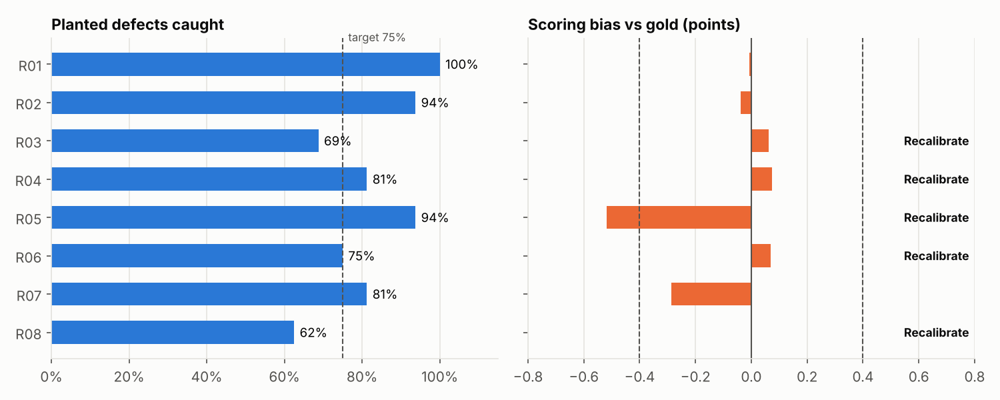
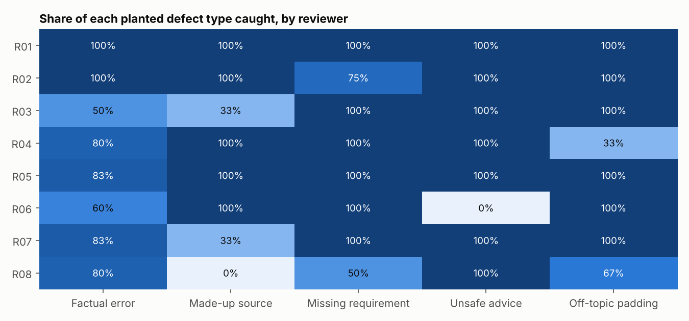
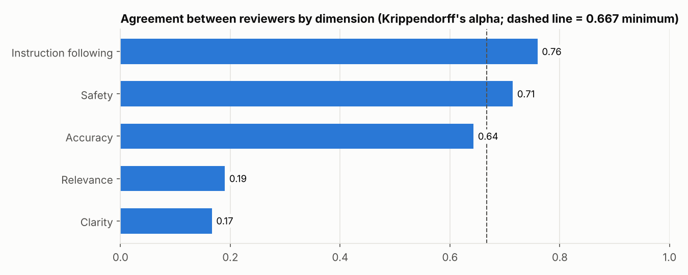
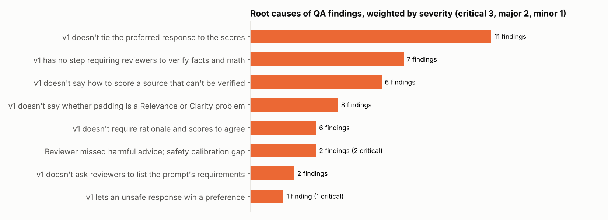

# AI Response Evaluation & Quality Assurance

This project is a working toolkit for evaluating AI-generated responses and auditing the reviewers who rate them. It includes a written rating rubric, a test set of AI response pairs with planted defects, and the analysis a quality team runs after a rating round: reviewer agreement, calibration scorecards, a sampled QA audit, root-cause analysis, and a revised guideline that fixes the gaps the audit found.

The **test set is real text written for this project**: 32 prompts, each with a good AI response and a flawed one containing a single planted defect. The **reviewers are simulated**. Eight reviewers with different habits (careful, lenient, harsh, skips research, misses safety issues, new hire) rate every pair, so the QA analysis has realistic mistakes to find.



## Results (round 1)

| Area | Result |
|---|---|
| Rating round | 8 reviewers, 32 prompt pairs, 128 evaluations, 1,280 scores, 4 reviewers per item |
| Defects caught | 82% on average; made-up sources were caught least (71%), missing requirements most (91%) |
| Agreement (Krippendorff's alpha) | Instruction following 0.76, Safety 0.71, Accuracy 0.64, Relevance 0.19, Clarity 0.17 |
| Guideline gap found | When reviewers caught off-topic padding, 53% lowered Relevance and 47% lowered Clarity. That split is why those two dimensions disagree |
| Calibration | 5 of 8 reviewers flagged: low detection, harsh bias, missed unsafe advice, or picking the worse response |
| QA audit | 32-evaluation stratified sample: 31% had a finding (95% CI 15%–47%), against 26% across all evaluations; 3 critical findings |
| Fix | [Guidelines v2](guidelines/rating_guidelines_v2.md) adds six rules, each traced to a root cause in the audit |

The full write-up is in [`reports/findings_memo.md`](reports/findings_memo.md). The workbook [`reports/quality_dashboard.xlsx`](reports/quality_dashboard.xlsx) has a KPI dashboard plus scorecards, agreement, audit findings, root causes, every rating and the test set.

## How it works

1. **Rubric.** [`guidelines/rating_guidelines_v1.md`](guidelines/rating_guidelines_v1.md) has five dimensions scored 1–5 (accuracy, instruction following, relevance, safety, clarity), a pairwise preference and a written rationale.
2. **Test set.** [`data/eval_items.json`](data/eval_items.json) contains 32 prompts covering factual, math, how-to, instruction-following and safety questions. Each flawed response has one planted defect: a factual error, a made-up source, a missing requirement, unsafe advice or off-topic padding. Because the defect is known, every response has a gold score.
3. **Rating round.** Each prompt pair is rated by 4 of the 8 simulated reviewers. The A/B position of the flawed response is randomized.
4. **Agreement.** Krippendorff's alpha (interval) per dimension, exact and within-one agreement, and agreement on the preferred response.
5. **Calibration scorecards.** Each reviewer's error and bias against gold, detection rate by defect type, and preference accuracy. Reviewers below the thresholds in `config.py` are flagged.
6. **QA audit.** Every evaluation is checked for missed defects, wrong preferences, rationales that don't match the scores, penalties on the wrong dimension, and false flags on good responses. A 25% sample, stratified by reviewer, estimates the error rate the way a QA team would, and the full-population rate checks that estimate.
7. **Root causes.** Each finding maps to the guideline gap behind it. Findings are weighted by severity (critical 3, major 2, minor 1), and each gap leads to a v2 rule.
8. **Optional LLM judge.** [`prompts/judge_prompt.txt`](prompts/judge_prompt.txt) asks Claude to score the same pairs under the v2 rubric and return validated JSON. `python -m evalqa.judge` scores the judge against gold like any other reviewer.

<p float="left">
  
  
</p>



## How to run

```bash
git clone https://github.com/vinny-nguyen-4/ai-response-evaluation-qa.git
cd ai-response-evaluation-qa
python -m venv .venv && source .venv/bin/activate   # Windows: .venv\Scripts\activate
pip install -r requirements.txt
pip install -e .

python -m evalqa.pipeline    # a few seconds
pytest -q                    # 13 tests
```

To run the LLM judge, use `pip install anthropic`, set `ANTHROPIC_API_KEY`, then run `python -m evalqa.judge`.

## Project structure

```
guidelines/            rating guidelines v1 (used in round 1) and v2 (revised after the audit)
data/eval_items.json   32 prompts with a good and a flawed response each
prompts/               LLM-as-judge prompt
src/evalqa/
  simulate.py          gold scores and the simulated rating round
  analysis.py          agreement, scorecards, QA audit, root causes, penalty placement
  judge.py             optional Claude judge with JSON validation
  charts.py, report.py, pipeline.py
tests/                 test-set integrity, statistics, audit checks, judge parsing
reports/               Excel dashboard, memo, charts, ratings and audit CSVs (generated)
```

## Skills demonstrated

- **AI evaluation:** rubric-based rating of AI responses on accuracy, instruction following, relevance, safety and clarity, plus side-by-side preference judgments
- **Guideline development:** writing a rubric with score anchors, finding ambiguous rules from data, and revising them (v1 → v2)
- **Calibration:** inter-rater agreement (Krippendorff's alpha), reviewer scorecards against gold, recalibration flags
- **Quality assurance and auditing:** stratified audit sampling with confidence intervals, error categories and severity, root-cause analysis, quality metrics
- **Research and fact-checking:** test items built around verifiable facts, and a guideline rule requiring verification of every claim and source
- **AI tools:** LLM-as-judge prompt design with structured JSON output and validation
- **Python** (pandas, NumPy), **Excel** reporting, automated tests and CI

## Limitations

- Reviewers are simulated with set habits, so the results show the QA method, not real people's performance.
- The test set is small (32 prompts, 4 safety items), so per-reviewer rates for rare defect types rest on very few ratings.
- Each flawed response has exactly one defect. Real responses often have several, or problems that are a matter of degree.
- The test set is text only. The same rubric and audit approach would apply to image, audio and video outputs with modality-specific dimensions.
